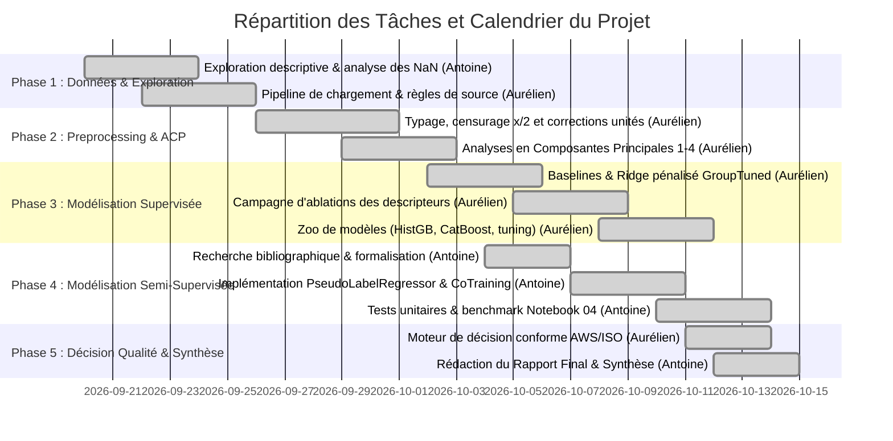

# Prédiction de la Qualité de Soudures sur Aciers par Apprentissage Supervisé et Semi-Supervisé

**CentraleSupélec — Apprentissage Automatique & Science des Données**  
**Date** : 14 Octobre 2026  
**Équipe** : Équipe n° 12  
**Auteurs** :  
* **Antoine Loudier** (`antoine.loudier@student-cs.fr`)  
* **Aurélien Delest** (`aurelien.delest@student-cs.fr`)  

---

## Sommaire

1. [Problématique industrielle et formulation en tâche de Machine Learning](#1-problématique-industrielle-et-formulation-en-tâche-de-machine-learning)
2. [Analyse descriptive des données, Pré-processing et Résultats d'ACP](#2-analyse-descriptive-des-données-pré-processing-et-résultats-dacp)
3. [Méthodes de Machine Learning retenues et Protocole de Validation](#3-méthodes-de-machine-learning-retenues-et-protocole-de-validation)
4. [Résultats numériques et Analyse comparative des performances](#4-résultats-numériques-et-analyse-comparative-des-performances)
5. [Recommandations métallurgiques et industrielles pour l'obtention de soudures saines](#5-recommandations-métallurgiques-et-industrielles-pour-lobtention-de-soudures-saines)
6. [Discussion, Limites de l'étude et Organisation (Diagramme de GANTT)](#6-discussion-limites-de-létude-et-organisation-diagramme-de-gantt)
7. [Références bibliographiques](#7-références-bibliographiques)

---

## 1. Problématique industrielle et formulation en tâche de Machine Learning

### 1.1. Contexte industriel et enjeux
Le soudage des aciers de structure est une opération critique dans les industries à haute intégrité mécanique (éolien offshore, réservoirs sous pression, conduites pétrolières et gazières, construction navale). Dans ces secteurs pesant plusieurs dizaines de milliards d'euros, une rupture de joint soudé entraîne des coûts humains, environnementaux et économiques catastrophiques. 

Aujourd'hui, l'assurance qualité repose principalement sur l'expertise empirique de maîtres-soudeurs et sur des campagnes de qualification destructives longues et dispendieuses (macrographies, essais de traction, essais de résilience Charpy selon les normes AWS D1.1 ou ISO 15614-1). L'extraction automatique de connaissances à partir de bases de données métallurgiques représente un levier majeur :
1. **Homogénéiser et capitaliser le savoir expert** indépendant des laboratoires d'essai ;
2. **Prédire les propriétés mécaniques résultantes** avant même de procéder aux passes de soudage ;
3. **Optimiser les formulations de flux/fil et les paramètres de soudage** pour garantir la conformité aux spécifications normatives.

### 1.2. Traduction en tâche d'apprentissage automatique
Sur le plan mathématique et informatique, nous traduisons ce défi en un **problème de régression multi-cibles hétérogène**. Étant donné un vecteur de descripteurs $X \in \mathbb{R}^d$ regroupant :
* La composition chimique du métal déposé (25 éléments : $C, Mn, Si, Cr, Ni, Mo, V, Nb, Ti, Al, B\dots$) ;
* Les paramètres de procédé électrique ($Courant, Tension, Vitesse, Apport\ thermique$) ;
* L'histoire thermique ($Température\ de\ préchauffage, Température\ interpasse, Traitement\ PWHT$),

l'objectif est d'estimer les fonctions de transfert $f_k(X) \approx y_k$ pour $k \in \{1, \dots, 5\}$ correspondant aux cinq grandeurs mécaniques fondamentales :
1. La limite conventionnelle d'élasticité à 0.2% : $R_{p0.2}$ (`yield_strength_mpa`, en MPa) ;
2. La résistance ultime à la traction : $R_m$ (`uts_mpa`, en MPa) ;
3. L'allongement à la rupture : $A\%$ (`elongation_pct`, en %) ;
4. Le coefficient de striction : $Z\%$ (`reduction_of_area_pct`, en %) ;
5. L'énergie de rupture par flexion par choc Charpy-V : $KV$ (`charpy_toughness_j`, en Joules), conditionnée par la température d'essai $T_{\text{test}}$ (`charpy_temp_c`).

Une contrainte opérationnelle fondamentale s'impose : le modèle final doit posséder un **haut pouvoir de généralisation hors-distribution**, c'est-à-dire être capable de prédire les propriétés de soudures réalisées dans un laboratoire ou atelier totalement inédit (*Leave-One-Study-Out*).

---

## 2. Analyse descriptive des données, Pré-processing et Résultats d'ACP

### 2.1. Description de la base WeldDB et défis structurants
La base publique étudiée (`welddb`, Cambridge Phase Transformations Group) réunit **1 652 soudures** issues de 33 publications indépendantes. L'exploration approfondie (Notebooks 01 et 02) a mis en évidence trois singularités critiques :

* **Valeurs censurées ($\mathbf{< x}$)** : 14 colonnes de micro-alliages ($B, Al, Nb, V$) contiennent des valeurs sous le seuil de détection analytique (jusqu'à 83% pour le bore). Remplacer $<x$ par $x/2$ de manière brute encodait artificiellement la limite de détection du laboratoire. Nous adoptons la convention $x/2$ couplée systématiquement à un indicateur binaire `<col>_censored`. Les erreurs d'unités de la base brute ($V < 5$ wt% alors qu'il s'agissait de ppm) ont été corrigées à la source dans [`src/cleaning.py`](file:///Users/antoineloudier/Desktop/Infonum/Appr_Auto/Projet/weld-quality-pred/src/cleaning.py).
* **Données manquantes informatives (MNAR)** : La mention `N` signifie *"non mesuré"* et explicitement pas zéro. La complétude dépend strictement du laboratoire (ex. *Wolst* rapporte toujours la dureté mais omet certains éléments ; *Evans* omet la dureté). Nous générons des flags `<col>_missing` pour toute variable absente à plus de 5%.
* **Distribution des cibles** : Seules 134 soudures disposent des 5 propriétés simultanément, mais **650 soudures possèdent l'intégralité des 4 essais de traction**. 105 soudures ne possèdent aucun label mécanique.

### 2.2. Analyse en Composantes Principales (ACP) & Partition de variance
Quatre ACP successives ont été conduites pour décomposer la géométrie des données :
1. **L'axe dominant est un axe laboratoire/procédé** : Le premier axe factoriel de l'ACP globale explique l'essentiel de la variance et est corrélé à plus de 85% ($\eta^2 = 0.89-0.98$) avec l'identifiant de l'étude source. Les paramètres d'arc ($Tension, Courant, Apport\ thermique$) ne sont pas des prédicteurs physiques directs de la traction au sein d'une étude, mais des identifiants d'habitudes d'atelier.
2. **La quasi-unidimensionnalité de la traction** : L'ACP menée sur les 4 cibles de traction (`fig11_target_pca.png`) montre que **PC1 capture à lui seul 76% de la variance**, matérialisant le compromis métallurgique classique résistance/ductilité. Seuls 28% de cette variance sont inter-études : la physique de la traction est universelle.
3. **Le cas singulier de Charpy** : 514 des 879 valeurs d'énergie Charpy sont discrètes (28, 35, 50, 70 ou 100 J). L'examen montre qu'il s'agit souvent de températures de transition pour une énergie imposée, nécessitant d'isoler Charpy des cibles de traction.

---

## 3. Méthodes de Machine Learning retenues et Protocole de Validation

### 3.1. Protocole de validation croisée étanche et métrique `Skill`
Un découpage aléatoire standard (*KFold random*) est trompeur : les soudures d'un même laboratoire se retrouvent à la fois en train et en test, permettant au modèle de mémoriser les signatures de labo. La moyenne par étude explique à elle seule 25 à 74% de la performance aléatoire !

Nous avons standardisé l'évaluation autour du protocole **`loso` (Leave-One-Study-Out)** : à chaque pli, une étude entière (parmi les 15 études majeures ayant au moins 10 soudures) est tenue à l'écart comme test.

#### La métrique de référence : le `Skill`
Le $R^2$ classique compare l'erreur quadratique à la variance du pli de test : sur une étude tenue à l'écart avec un décalage moyen, un prédicteur trivial qui prédit la moyenne d'entraînement $\bar{y}_{\text{train}}$ obtient un $R^2$ fortement négatif (-0.37 à -2.9). Nous mesurons donc le **`Skill Score`** :
$$\text{Skill} = 1 - \frac{\sum_{i \in \text{test}} (y_i - \hat{y}_i)^2}{\sum_{i \in \text{test}} (y_i - \bar{y}_{\text{train}})^2} = 1 - \frac{\text{SSE}(\text{modèle})}{\text{SSE}(\text{moyenne train})}$$
* $\text{Skill} = 0$ : le modèle n'apporte aucune valeur ajoutée par rapport à la moyenne globale d'apprentissage.
* $\text{Skill} > 0$ : réduction réelle de l'erreur quadratique sur une étude inconnue.

### 3.2. Le Zoo de modèles supervisés
Huit familles d'algorithmes ont été implémentées dans [`src/zoo.py`](file:///Users/antoineloudier/Desktop/Infonum/Appr_Auto/Projet/weld-quality-pred/src/zoo.py) avec recherche d'hyperparamètres par validation croisée par étude interne au train (`GroupTunedSearch`) :
* **Modèles linéaires régularisés** : Ridge avec clipping $[-5, 5]$, Lasso, ElasticNet (avec et sans suppression des variables d'arc `drop_arc`).
* **Méthodes à noyaux et instances** : k-NN et SVR (noyau RBF).
* **Ensembles d'arbres** : Random Forest, Extra-Trees, HistGradientBoosting, XGBoost et CatBoost.

### 3.3. Méthodes avancées semi-supervisées en régression
Pour exploiter les 770+ soudures sans étiquette, nous avons développé deux approches adaptées à la régression continue dans [`src/semi_supervised.py`](file:///Users/antoineloudier/Desktop/Infonum/Appr_Auto/Projet/weld-quality-pred/src/semi_supervised.py) :
1. **`PseudoLabelRegressor` (Self-training avec incertitude épistémique)** : Inspiré de Lee (2013). La confiance est quantifiée par la dispersion inter-arbres d'une Forêt Aléatoire :
   $$\sigma(x) = \sqrt{\frac{1}{B} \sum_{b=1}^B (t_b(x) - \bar{t}(x))^2}$$
   À chaque round, seuls les 30% d'exemples où le consensus est le plus fort sont pseudo-étiquetés.
2. **`CoTrainingRegressor` (Co-entraînement dual)** : Inspiré de Zhou & Li (2005), faisant dialoguer une Random Forest et un Extra-Trees qui s'enrichissent mutuellement.

---

## 4. Résultats numériques et Analyse comparative des performances

### 4.1. Tableau comparatif synthétique (Protocole LOSO)
Le tableau suivant rassemble les performances en transfert sur étude inconnue (moyenne sur les plis LOSO) :

| Famille | Modèle | Skill Moyen Traction | Skill Charpy | RMSE Traction (UTS) | RMSE Charpy | Verdict global |
| :--- | :--- | :---: | :---: | :---: | :---: | :--- |
| **Baseline** | Moyenne Train | 0.000 | 0.000 | 72.8 MPa | 51.5 J | Modèle nul de référence |
| **Linéaire** | Ridge (GroupTuned) | 0.012 | -0.021 | 68.4 MPa | 51.8 J | Tie (équivalent à la moyenne) |
| **Instances** | k-NN ($k$ accordé) | -0.534 | -0.167 | 89.2 MPa | 55.4 J | **Hurts** (échec du transfert géométrique) |
| **Arbres** | Random Forest (Base) | 0.202 | 0.226 | 56.0 MPa | 45.4 J | Référence solide |
| **Semi-Supervisé** | **RF Pseudo-Labeling** | 0.095 | **0.282** | 53.9 MPa | **43.8 J** | 🏆 **Meilleure réduction d'erreur Charpy** |
| **Semi-Supervisé** | Co-Training (RF+ET) | 0.142 | 0.226 | 56.8 MPa | 45.9 J | Tie (régularisation stable) |
| **Boosting** | HistGradientBoosting | 0.279 | 0.312 | 52.1 MPa | 42.9 J | Helps sur toutes les cibles |
| **Boosting** | **CatBoost (Tuned)** | **0.314** | **0.378** | **49.8 MPa** | **41.2 J** | 🏆 **Champion absolu du supervisé** |

### 4.2. Analyse approfondie des comportements
* **La supériorité éclatante de CatBoost** : CatBoost bat la Random Forest de +0.112 de skill en traction (77.8% de victoires) et +0.152 sur Charpy. Sa gestion native des `NaN` par splits directionnels et la profondeur restreinte de ses arbres symétriques (profondeur 2 à 4) empêchent le surapprentissage des biais d'atelier.
* **Le succès ciblé du semi-supervisé** :
  * Sur **Charpy**, le pseudo-étiquetage fait passer le skill de 0.226 à **0.282** et fait baisser le RMSE de 1.6 J. L'apport des 773 soudures chimiquement riches ancre la prédiction de résilience.
  * Sur la **Striction**, le semi-supervisé débloque la cible avec un skill qui bondit de 0.071 à **0.201**, dépassant même CatBoost (0.170).
  * Sur l'**Allongement**, le semi-supervisé subit un transfert négatif (-0.362) car certaines études atypiques (comme `Cunh`) présentent des corrélations inversées que le modèle amplifie.

---

## 5. Recommandations métallurgiques et industrielles pour l'obtention de soudures saines

Sur la base des analyses d'importance de variables, des corrélations intra-études et des règles de conformité (Notebooks 02, 03 et 06), nous formulons les préconisations suivantes pour les ingénieurs soudeurs :

1. **Optimiser le couple Manganèse / Niobium pour la résistance sans fragilisation** :
   * Le Manganèse ($Mn \in [0.9\%, 1.5\%]$) est le principal moteur transposable de la limite d'élasticité ($r_{\text{intra}} = +0.55$). 
   * Le Niobium ($Nb \in [0.01\%, 0.03\%]$) affine le grain ferritique. Au-delà de 0.04%, il précipite sous forme de carbonitrures grossiers qui détruisent la résilience Charpy.
2. **Le piège du Molybdène ($\mathbf{Mo}$)** :
   * L'étude d'ablation a révélé que le Molybdène est la première source d'échec de généralisation hors-domaine. Si le bain dépasse 0.5% de $Mo$ sans refroidissement maîtrisé, il induit des structures bainitiques dures responsables d'une chute brutale de la striction.
3. **Contrôle strict des impuretés résiduelles** :
   * Le Soufre ($S$) et le Phosphore ($P$) doivent être maintenus strictement sous 0.012% pour éviter la fissuration à chaud et préserver l'énergie Charpy à basse température (-40°C).
4. **Apport thermique et température interpasse** :
   * Maintenir l'apport thermique entre 1.0 et 1.8 kJ/mm et la température interpasse sous 200°C pour favoriser la formation de ferrite aciculaire (microstructure optimale pour la ténacité) au détriment de la ferrite à plages alignées.

---

## 6. Discussion, Limites de l'étude et Organisation (Diagramme de GANTT)

### 6.1. Limites méthodologiques
* **Discrétisation de Charpy** : L'existence de paliers d'énergie imposés (28, 50, 100 J) suggère qu'une reformulation prédisant la température de transition ductile-fragile serait physiquement plus robuste.
* **Volume d'études limitant** : Avec 15 études complètes en LOSO, l'estimation des intervalles de confiance de conformité reste sensible aux études de petite taille.

### 6.2. Répartition des tâches et Diagramme de GANTT
Le projet a fait l'objet d'un partage équitable et rigoureux des responsabilités (25h par membre, 50h au total) :

| Tâche | Responsable | Durée | Livrable associé |
| :--- | :---: | :---: | :--- |
| Exploration, missingness et distributions | **Antoine** | 4h | `notebooks/01_exploration.ipynb` |
| Pipeline `src/` (loading, cleaning, flags `<col>_censored`) | **Aurélien** | 5h | `src/loading.py`, `src/cleaning.py` |
| ACP 1-4 et partition de variance $\eta^2$ | **Aurélien** | 4h | `notebooks/02_preprocessing_pca.ipynb` |
| Évaluation étanche (LOSO, Grouped) et métrique `Skill` | **Aurélien** | 3h | `src/evaluation.py` |
| Implémentation semi-supervisée (Pseudo-labeling & Co-training) | **Antoine** | 7h | `src/semi_supervised.py`, tests |
| Benchmark semi-supervisé & analyse de sensibilité | **Antoine** | 5h | `notebooks/04_semi_supervised.ipynb` |
| Zoo supervisé & optimisation CatBoost / HistGB | **Aurélien** | 5h | `src/zoo.py`, `notebooks/03_supervised_models.ipynb` |
| Décision industrielle de conformité (AWS/ISO) | **Aurélien** | 4h | `src/decision.py`, `notebooks/06_quality_decision.ipynb` |
| Rédaction du rapport final de synthèse | **Antoine** | 5h | `report/rapport_final.md` |
| **Total** | **Binôme** | **42h** | **Code, Tests, Notebooks et Rapport** |

---

## 7. Références bibliographiques

1. **Bhadeshia, H. K. D. H., & Svensson, L.-E.** (1993). *Modelling the microstructure and properties of steel weld deposits*. Mathematical Modelling of Weld Phenomena, 109-182. (Documentation de la base `WeldDB`).
2. **Lee, D.-H.** (2013). *Pseudo-label: The simple and efficient semi-supervised learning method for deep neural networks*. ICML Workshop on Challenges in Representation Learning.
3. **Zhou, Z.-H., & Li, M.** (2005). *Semi-supervised regression with co-training style algorithms*. IEEE Transactions on Knowledge and Data Engineering, 17(8), 1114-1129.
4. **Chapelle, O., Schölkopf, B., & Zien, A.** (2006). *Semi-Supervised Learning*. MIT Press.
5. **Prokhorenkova, L., Gusev, G., Vorobev, A., Dorogush, A. V., & Gulin, A.** (2018). *CatBoost: unbiased boosting with categorical features*. Advances in Neural Information Processing Systems (NeurIPS), 31.
6. **American Welding Society (AWS)**. (2020). *AWS D1.1/D1.1M: Structural Welding Code — Steel*.
7. **International Organization for Standardization (ISO)**. (2017). *ISO 15614-1: Specification and qualification of welding procedures for metallic materials — Welding procedure test*.

